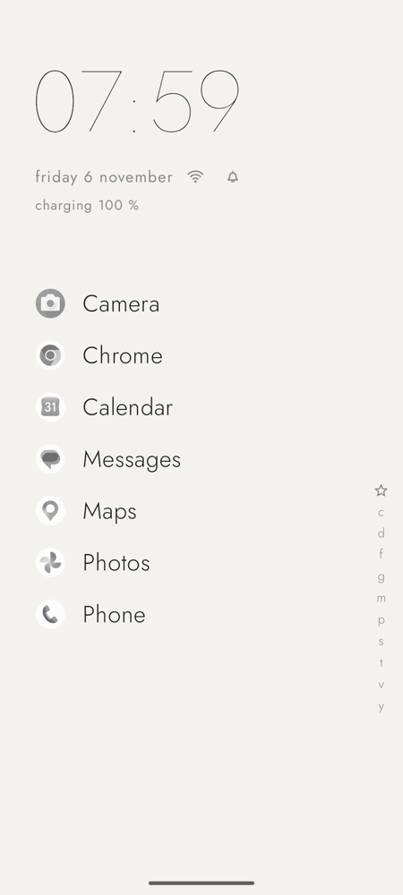
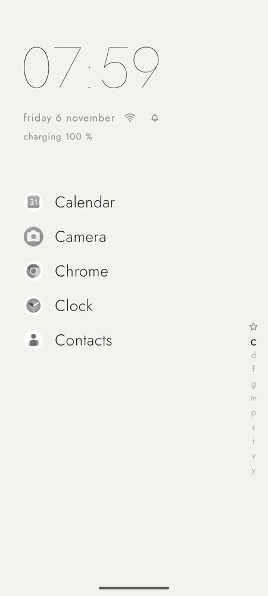
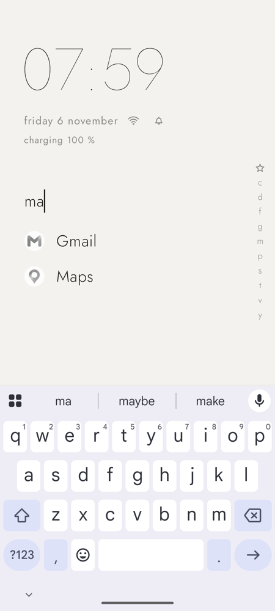
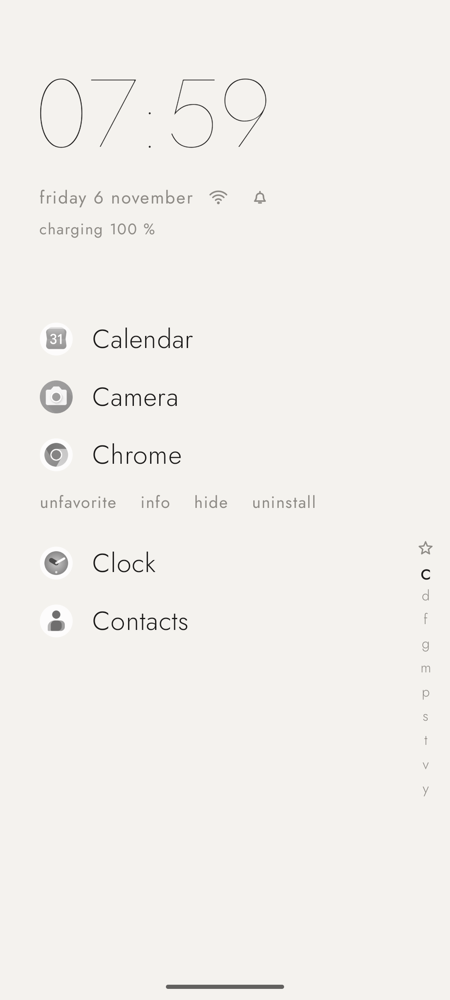
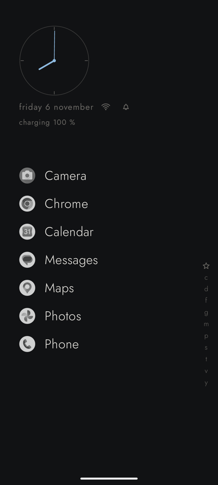
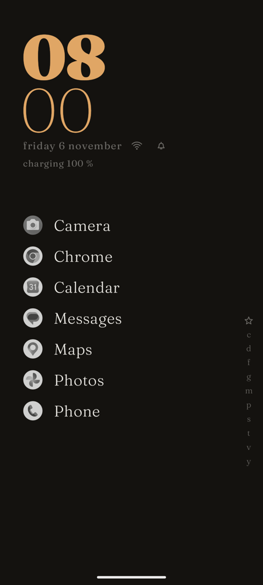
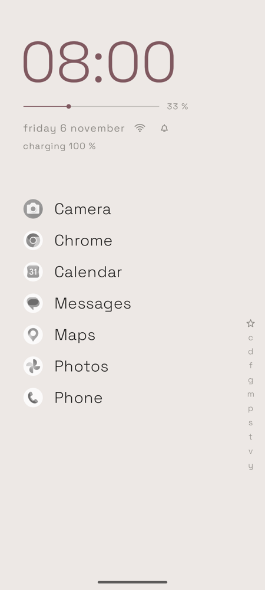
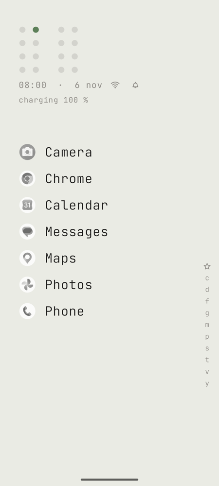
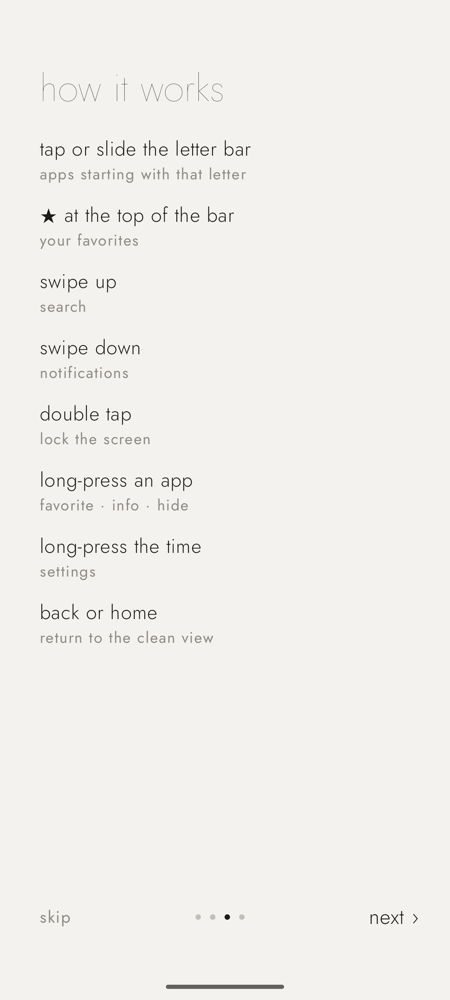
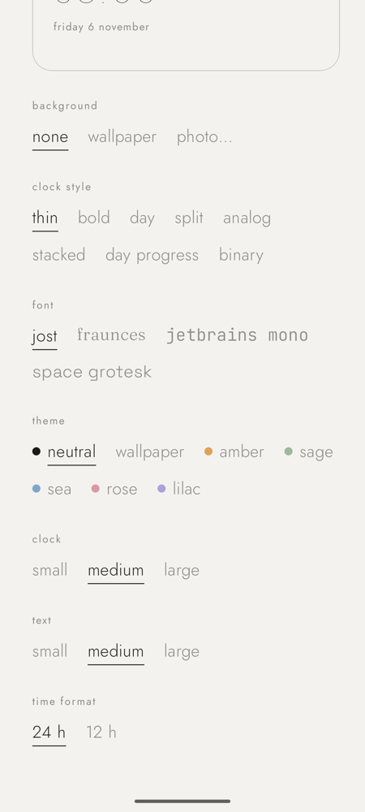

# Minimal

Launcher de Android minimalista: un reloj, una barra de letras y nada más. Tipografía fina, iconos en gris, sin cajón de apps ni anuncios.

<p>
  
  
  
  
</p>
<p>
  
  
  
  
</p>

## Descargar e instalar

1. En el teléfono, abre **[Releases](../../releases/latest)** y descarga `minimal-x.y.z.apk`.
2. Ábrelo. Android pedirá permitir instalar apps de esa fuente (navegador o Archivos) → **Permitir**.
3. Si aparece Play Protect ("app desconocida"), toca **Más detalles → Instalar de todas formas**. Es normal en apps que no vienen de Play Store.
4. Abre **Minimal**: una introducción corta te ayuda a ponerlo como pantalla de inicio.

Requiere Android 8.0 o superior. Las actualizaciones se instalan igual, encima de la versión anterior, sin perder tus ajustes.

Para volver a tu launcher anterior: Ajustes → Aplicaciones → Aplicaciones predeterminadas → Aplicación de inicio.

## Qué tiene

- **Barra de letras** a la derecha, izquierda (zurdos) o abajo, con burbuja y vibración ajustable. La **★** arriba muestra tus favoritos.
- **8 estilos de reloj**: fino, grueso, día, partido, analógico, apilado, progreso del día y binario.
- **4 fuentes**: Jost, Fraunces, JetBrains Mono y Space Grotesk.
- **Temas**: un color de acento (ámbar, salvia, mar, rosa, lila) o tomado de tu fondo de pantalla. Sigue el modo claro/oscuro del sistema.
- **Bajo la hora**, lo que elijas: fecha, clima, modo de sonido, wifi/datos, batería, próxima alarma, próximo evento, notificaciones.
- **Responder mensajes desde el inicio** (WhatsApp, Telegram, SMS…) con respuestas sugeridas.
- **Mini reproductor** cuando suena música.
- **Recientes**, **apps ocultas**, fondo propio (foto en blanco y negro o el del sistema), widgets opcionales y **modo conducción**.

## Cómo se usa

| Gesto | Qué hace |
|---|---|
| Tocar o deslizar por la **barra de letras** | Apps que empiezan por esa letra |
| Tocar la **★** de la barra | Tus favoritos |
| **Deslizar hacia arriba** | Buscar (la tecla → abre el primer resultado) |
| **Deslizar hacia abajo** | Panel de notificaciones |
| **Doble toque** | Bloquear la pantalla |
| Tocar la **hora** / la **fecha** | Alarmas / calendario |
| **Mantener pulsada** una app | `favorito · info · ocultar · desinstalar` |
| **Mantener pulsada** la hora | Ajustes del launcher |
| **Atrás** o **Inicio** | Vuelve a la vista limpia |

Los gestos se pueden cambiar en ajustes → gestos.

<p>
  
  
</p>

## Permisos (todos opcionales)

Cada uno activa una sola función; sin ellos el launcher funciona igual. Se pueden dar en la introducción o en ajustes → permisos.

| Permiso | Para qué |
|---|---|
| Acceso a notificaciones | Puntos •, contador y responder mensajes desde el inicio |
| Accesibilidad | Solo bloquear la pantalla con doble toque; no lee nada |
| Datos de uso | La fila de apps recientes |
| Calendario | Tu próximo evento bajo la hora |
| Ubicación aproximada | El clima |

En Samsung, si un ajuste sale como restringido: Ajustes → Aplicaciones → Minimal → ⋮ → *Permitir ajustes restringidos*.

**Privacidad**: no hay cuentas, anuncios ni analíticas. La única conexión a internet es el clima ([Open-Meteo](https://open-meteo.com), con tu ubicación aproximada). Los mensajes y notificaciones se quedan en memoria, nunca se guardan ni se envían.

## Compilar

Necesitas Android Studio (trae el JDK y el SDK).

```bash
export JAVA_HOME="/Applications/Android Studio.app/Contents/jbr/Contents/Home"
./gradlew installDebug       # compila e instala en el teléfono conectado
./gradlew assembleRelease    # APK firmado (necesita keystore.properties, ver abajo)
```

Para firmar el release, crea `keystore.properties` en la raíz (está en `.gitignore`):

```properties
storeFile=/ruta/a/tu-keystore.jks
storePassword=…
keyAlias=…
keyPassword=…
```

Kotlin + Jetpack Compose, una sola Activity, sin más dependencias que `activity-compose` y `compose-foundation`.

## Créditos

Fuentes bajo SIL Open Font License: [Jost](https://github.com/indestructible-type/Jost) ([licencia](FONT-LICENSE-Jost.txt)), [Fraunces](https://github.com/undercasetype/Fraunces) ([licencia](FONT-LICENSE-Fraunces.txt)), [JetBrains Mono](https://github.com/JetBrains/JetBrainsMono) ([licencia](FONT-LICENSE-JetBrainsMono.txt)), [Space Grotesk](https://github.com/floriankarsten/space-grotesk) ([licencia](FONT-LICENSE-SpaceGrotesk.txt)). Clima de [Open-Meteo](https://open-meteo.com).
